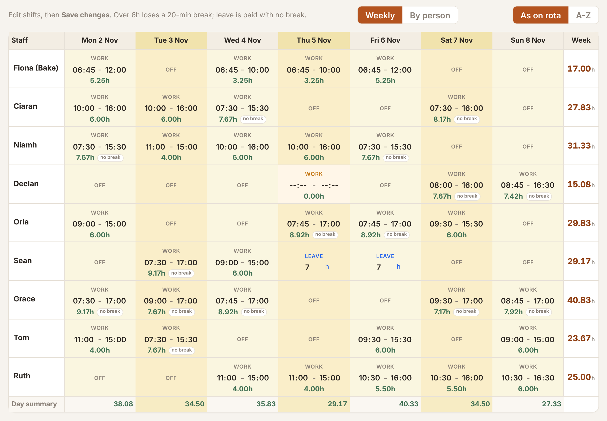
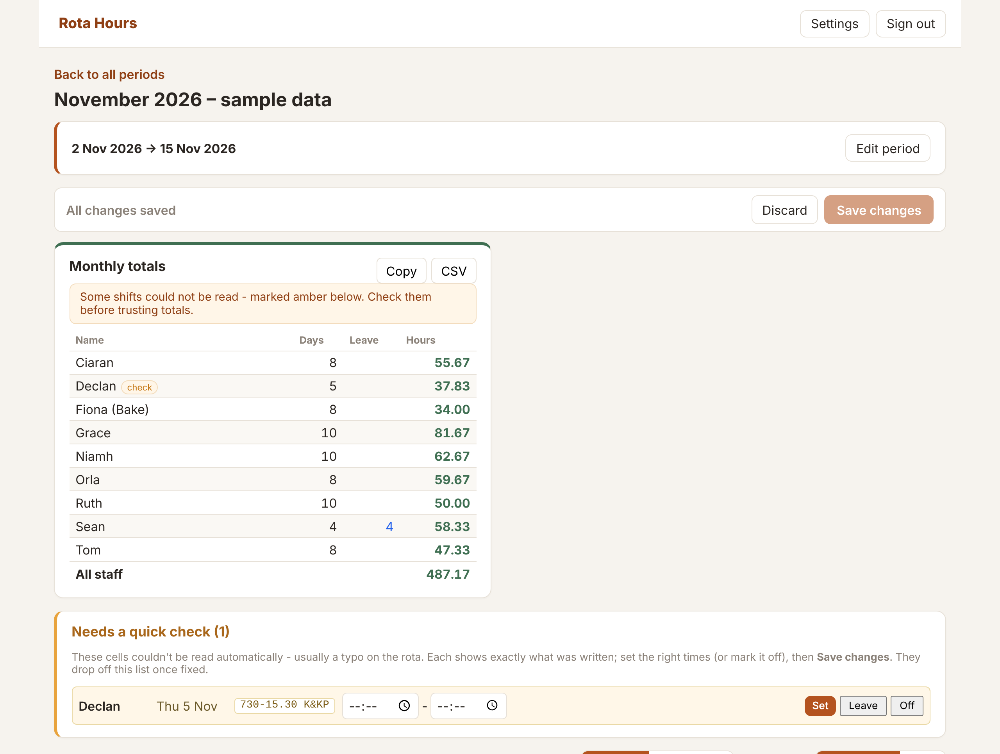

# Café Rota Hours

Every month, staff hours at the café where I work had to be added up by hand for payroll. This app does it instead: upload the weekly rota PDFs, check anything it flags, and read off one total per person.

It's in live use at the café every month – I review it with the owner and release fixes from his feedback.

**Live site:** https://cafe-rota-hours-app.vercel.app (manager login required)

**Stack:** React (Vite) · Express (Node) · Python (pdfplumber) · PostgreSQL (Neon) · Vercel





*Screenshots use made-up staff and shifts.*

## What it does

- **Upload** weekly rota PDFs into a library; re-uploading a week replaces it.
- **Reads the table by text position** (Python/pdfplumber), so multi-word and split shifts stay in the right day.
- **Builds a pay period** from the stored rotas for any date range, so days from the next or previous month are left out.
- **Applies the break rule:** a shift longer than 6 hours loses a 20-minute unpaid break. Exactly 6 hours keeps all 6, and a "no break" toggle pays the full time when the break wasn't taken.
- **Handles split and role-change shifts** like `6.45-8B, 15.00 F&G` (one block, 06:45–15:00) and strips role tags (`K&KP`, `F&G`, `Bake`…).
- **Paid leave:** `OFF (L)` days are marked as leave; you enter the hours to pay, with no break deducted.
- **Never guesses:** any cell it can't read (usually a typo on the rota) is flagged **check**, listed for a quick fix, and left out of the totals until it's fixed.
- **Keeps two people with the same name separate**; each row can be renamed.
- **Editable grid** (weekly or per person) with manual save, plus copy-to-clipboard and CSV export of the totals.
- **Staff change requests:** staff can submit shift changes on a PIN-protected page (`#request`); the manager accepts or rejects them.

## Rota template

[`templates/Cafe Rota Template.xlsx`](templates/Cafe%20Rota%20Template.xlsx) is an Excel template in the layout the parser expects. Type the week's Monday, fill in the shifts, then **Save As → PDF (Active sheet)** and upload it.

## How I used AI

The PDF-parsing function (`api/parse.py`) was written with AI, as my Python was rusty. I checked its output against months that had already been worked out before relying on it. The API, pay rules, database and front end are my own.

## Next

- Automated tests for the pay rules (`api/_lib/shifts.js`).

## Architecture

```
Browser (React)
   │  1. POST /api/parse   (PDF files)  ─────────►  Python function  (api/parse.py, pdfplumber)
   │  ◄── weeks JSON (raw weekly grid) ───────────
   │
   │  2. POST /api/rotas/ingest, /api/months ────►  Node/Express     (api/index.js)
   │                                                 stores rotas, builds pay periods,
   │  ◄── saved period id ────────────────────────   applies hour rules, saves to Postgres
   │
   └─ 3. GET/PATCH /api/... editing & summary  ───►  Node/Express  ◄──►  Postgres
```

Why split it this way: pdfplumber gives clean word-with-coordinate output, which makes the positional table extraction much simpler and sturdier than doing it in Node. Everything else – auth, the break and leave rules, date ranges, storage – stays in one place in the Node API.

## Project layout

```
api/
  parse.py            Python (Flask + pdfplumber): PDF -> weekly grid JSON   [/api/parse]
  index.js            Express app (one Vercel Node function)                 [/api/*]
  _lib/
    shifts.js         time parsing (HH.MM) + break rule
    buildShifts.js    date ranges + shift records
    db.js             Postgres pool + schema (auto-created)
    auth.js           manager account (bcrypt) -> JWT
src/                  React front end (Vite)
templates/            Excel rota template
docs/screenshots/     README images
requirements.txt      Python deps (flask, pdfplumber, PyJWT, python-dotenv)
dev-server.js         runs the Node API locally
vite.config.js        dev proxy: /api/parse -> :3002 (Python), /api/* -> :3001 (Node)
vercel.json           build + routing (/api/parse -> Python, rest -> Node)
```

## The hours logic (`api/_lib/shifts.js`)

Times are read as `HH.MM` (so `6.45` = 06:45, not 6.75 hours). Paid time is `end - start`, minus 20 minutes if that span is **strictly greater** than 6 hours. Split shifts written with a comma count as one continuous block from the first time to the last. Leave is paid at the hours entered, with no break deducted.

---

## Run it locally

You'll run three things: the **Vite** web app, the **Node** API and the **Python** parser.

### 1. Prerequisites

- Node.js 18+, Python 3.10+
- A free Postgres database – e.g. [Neon](https://neon.tech). Copy its connection string.

### 2. Get the code

```bash
git clone https://github.com/karrievoid/cafe-rota-hours-app.git
cd cafe-rota-hours-app
npm install
```

### 3. Set up the Python parser

**Windows (PowerShell):**
```powershell
python -m venv venv
venv\Scripts\Activate.ps1
pip install -r requirements.txt
```
**macOS / Linux:**
```bash
python3 -m venv venv
source venv/bin/activate
pip install -r requirements.txt
```

### 4. Environment file

```bash
# Windows: copy .env.example .env
cp .env.example .env
```

Fill in `.env`:

- `DATABASE_URL` – your Postgres connection string
- `JWT_SECRET` – any long random string (shared by the Node and Python functions)
- `STAFF_PIN` – optional; the PIN for the staff request page (can also be set in the app)

Tables are created automatically on first run.

### 5. Start it

Terminal 1 – Python parser (venv active):
```bash
python api/parse.py
```
Terminal 2 – Node API and web app:
```bash
npm run dev
```

Open http://localhost:5173. The first visit asks you to create the manager account (email and password).

### Common hiccups

- **Upload fails / 502:** the Python parser in Terminal 1 isn't running, or the venv isn't active.
- **"DATABASE_URL is not set":** `.env` isn't filled in, or the servers started before you saved it.
- **Port already in use:** change `PORT` / `PARSE_PORT` in `.env` and the ports in `vite.config.js`.

## Deploy to Vercel

1. Import the repo into Vercel – it detects Vite and the Python function.
2. Add `DATABASE_URL`, `JWT_SECRET` (and optionally `STAFF_PIN`) under **Settings → Environment Variables**.
3. Deploy. `vercel.json` routes `/api/parse` to Python and everything else to Node.

## Notes and limits

- The parser is tuned to this café's rota layout (month top-left, Monday–Sunday columns, one person per row). The Excel template above produces exactly that layout.
- One manager account per deployment.
